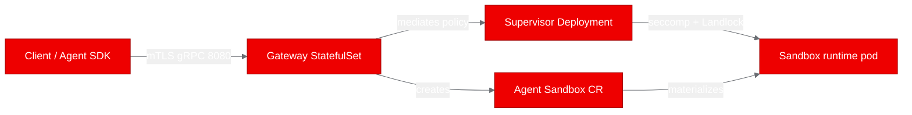
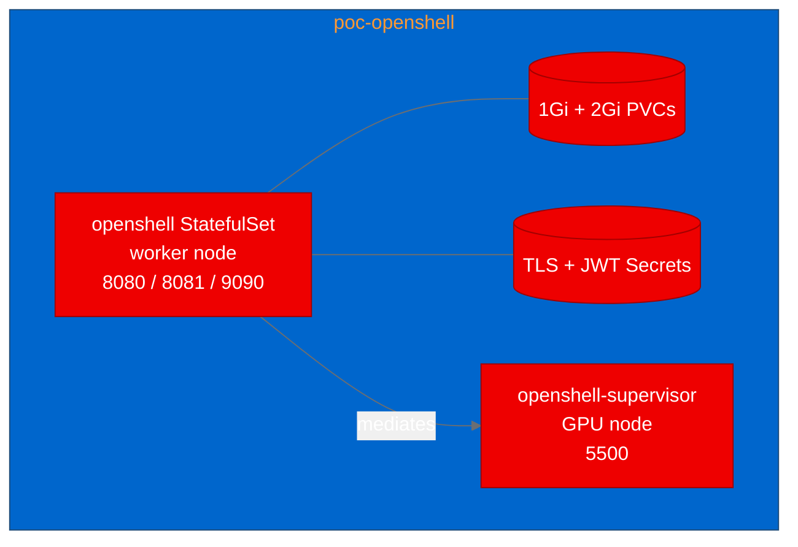
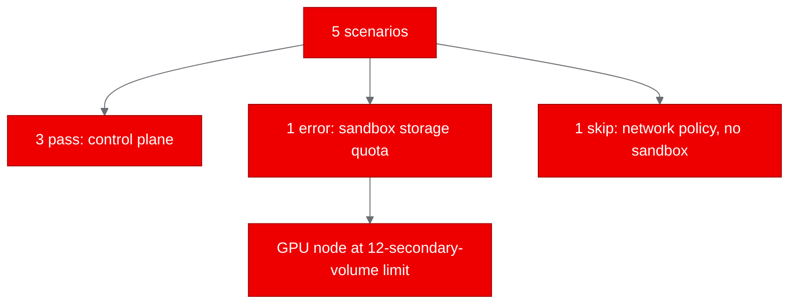

<!-- CHANGELOG — removed during finalization
v1: initial draft from PoC results (run a189bdf54ac849778a8ed7b228db599f). Explicit limited/failed scope: 3 pass, 1 error, 1 skip.
-->

## What is OpenShell?

OpenShell is NVIDIA's safe, private runtime for fleets of autonomous AI agents. Instead of trusting an agent process to behave, it instruments the Linux kernel: Landlock for filesystem policy, nested seccomp user-notification for syscall and network mediation, and `SO_BINDTODEVICE` to pin sockets. A Rust gateway fronts the control plane over gRPC, a trusted supervisor mediates each sandbox's traffic, and a workload-side sandbox runtime owns the agent's process tree. Policy changes are checked with z3 formal verification before they take effect.

The short version: it is a hard boundary you can put around an agent, and it ships with its own Helm chart for Kubernetes.

## Why it matters for OpenShift AI

OpenShift AI is where autonomous agent workloads increasingly run, and those workloads need a boundary that respects the platform rather than fighting it. OpenShell deploys through the Agent Sandbox controller and a standard Helm chart, targets the `restricted-v2` Security Context Constraints, and needs no privileged SCC. That makes it a natural fit alongside the rest of an OpenShift AI estate: the agents stay contained, and the platform keeps its usual RBAC and SCC story.

## Setting up for deployment

The repository is a Rust workspace of more than forty crates. For this proof of concept we treated three of them as deployable components: the gateway, the supervisor, and the sandbox runtime. The project already ships a Helm chart and a Python SDK, which is exactly what we wanted to lean on instead of writing our own manifests.

## Containerizing for OpenShift

Each component builds from the pinned source in a multi-stage UBI9 image. The builder stage installs the Rust toolchain plus the C and C++ compilers the vendored dependencies need, and the runtime stage is `ubi9/ubi-minimal` with the binary copied in and the final user set to 1001 for OpenShift's arbitrary-UID assignment.

This part took two retries, and both were worth writing down:

- UBI9 does not ship a standalone `libclang` package; it is provided by `clang-devel`. The first build failed at the package step until we used the right name.
- The gateway vendors z3 and compiles it with CMake. The first successful-looking toolchain picked GCC 11, which lacks the C++20 `std::format` support the code needs. Selecting the newer compiler toolchain fixed the build.

## Deploying to the cluster

We installed the project's own Helm chart into a dedicated namespace, `poc-openshell`, with the cluster-scoped RBAC turned off because a matching ClusterRole was already prepared out of band. The chart renders the gateway as a StatefulSet (it keeps a SQLite volume) and the supervisor as a Deployment. Both came up 1/1 Ready.

Two things deserve credit where it is due. Neither was the software healing itself:

- The supervisor's PodDisruptionBudget needed a namespace-scoped Role and RoleBinding that the operator provisioned, followed by a Helm upgrade to revision 2. That restored the PDB while preserving the existing TLS material.
- The gateway volume originally landed on the GPU node, which had already hit the cloud provider's 12-secondary-volume limit. The operator pinned the gateway to a worker node in the same zone with a `nodeSelector`, and that placement is now committed in the source so it reproduces.

## Running the PoC tests

We defined five scenarios and ran them against the live deployment. Here is the honest result: three passed, one errored, and one was skipped.

| Scenario | Result | What actually happened |
|---|---|---|
| gateway-health | Pass | HTTP 200, gateway reports healthy |
| gateway-metrics | Pass | HTTP 200, Prometheus exposition format |
| gateway-api | Pass | gRPC Health and sandbox listing over mTLS |
| sandbox-lifecycle | Error | Pod stuck `Init:0/2`; 240s wait timed out |
| network-policy-enforcement | Skip | No ready sandbox to run against |

The three passing scenarios are a real result: the control plane answers over mTLS, the health and metrics endpoints behave, and the gRPC API lists sandboxes. We are comfortable saying the gateway works on OpenShift.

The error is where it gets interesting, and it is not a bug in the software. The sandbox pod's persistent volume was bound, but the volume attachment never completed. The cloud provider's CSI driver reported an over-quota condition, 12 secondary volumes, on the GPU node, and the pod emitted `FailedAttachVolume` for the entire 240-second wait. That is a real storage limit on a real node, not a readiness race in the client. Because the sandbox never became ready, the network-policy scenario had nothing to attach to, so we recorded it as a skip rather than pretending it ran.

## What we learned

The control plane is solid on OpenShift, and the deployment story is genuinely first-class: a real Helm chart, the Agent Sandbox controller, and no privileged SCC. That is the part we would take to a team tomorrow.

The isolation story is where we stopped and looked. We are not claiming the kernel-mediated network and filesystem boundaries are proven, because the sandbox never got far enough to exercise them. A pod that is Ready is not the same thing as a sandbox that is isolated, and we would rather say that plainly than dress it up.

We also learned two practical lessons. First, UBI packaging has real edges: a missing `libclang` and a compiler that is too old for C++20 both cost us a build cycle. Second, a proof of concept runs on a real cluster with real quotas, and a 12-volume limit on a GPU node is exactly the kind of thing you only find by trying.

On the security side, one caveat matters. The gateway requires an mTLS client certificate, but it also promotes a certificate-verified caller to a local-development principal. That is the project's own posture for its OpenShift end-to-end tests, and it is fine for a proof of concept. It is not the same as production identity, and we did not test production OIDC here.

## Try it yourself

If you run OpenShift AI and you want a hard boundary around your agent workloads, OpenShell is worth a look. The AutoPoC pipeline built the images, deployed the chart, and ran the tests in one pass, and it told us exactly where the platform and the workload met.

Try deploying your own project with AutoPoC, and bring a workload that is a little ambitious. The failures are usually the most useful part.
