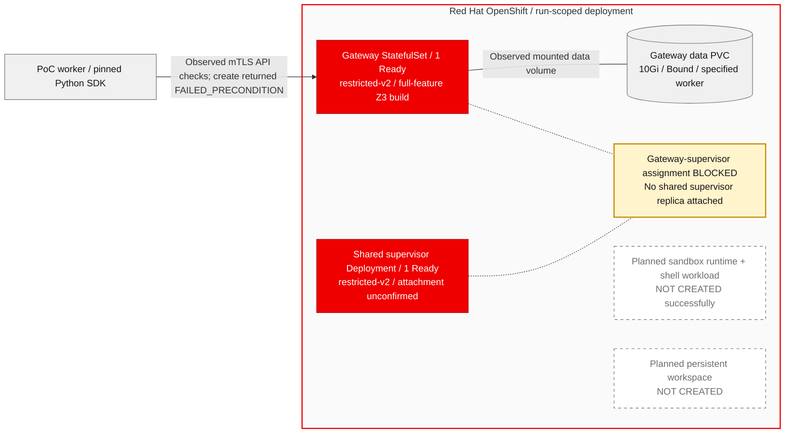

# OpenShell PoC Report

## Source Context

OpenShell is a policy-controlled runtime for autonomous AI agents. The pinned upstream README describes a gateway, supervisor and sandbox architecture intended to constrain agent file, system-call and network access at runtime, and to use formal verification to review policy changes before application. These are upstream design claims, not security properties demonstrated by this PoC. Source: `NVIDIA/OpenShell`, revision `f4a6137513b777c9b362be54baf388f7d45398aa`, `README.md` lines 19-28; the SDK and Kubernetes context appears at lines 48-49 and 64-73.

This report records a bounded OpenShift deployment and SDK validation attempt, not an end-to-end success story or production qualification.

## Executive Outcome

| Item | Recorded outcome |
| --- | --- |
| Run | `c00040c2196d4919b3e5b0a7fd947faf` |
| Date | 2026-11-10, UTC |
| Original execution capture | `0329dd4aa56e464092de68f894abe83a` |
| Terminal scenario totals | **1 pass, 0 fail, 1 error, 3 skip, 0 incomplete** |
| Scenario accounting | Five terminal scenarios, each captured once; no validation rerun |
| Test process exit code | `1` |
| Builds | Gateway, supervisor and sandbox builds all Complete; zero build retries |
| Deployment | Gateway and shared supervisor Ready under `restricted-v2`; gateway PVC Bound on the specified placement |
| Lifecycle objective | Not demonstrated: `CreateSandbox` returned `grpc_failed_precondition` because the gateway topology requires an attached shared supervisor |
| Root cause | Why the Rust supervisor did not attach remains unknown |
| Publication | Cloud publication blocked, outside authorization; prior Drive refresh failed and was not retried |

The passing scenario establishes workload readiness and the tested positive/negative mTLS API behavior. It does not establish sandbox execution. No usable sandbox or persistent workspace was created for the planned lifecycle checks. The build and workload readiness results remain valid, but the central objective of a usable SDK-driven sandbox lifecycle was not achieved.

## Objective And Scope

The question was whether fresh, source-built UBI OpenShell components could run under OpenShift `restricted-v2` and provide a usable sandbox lifecycle through the pinned source SDK.

The exact planned scope was five checks: gateway/supervisor readiness with authenticated and no-client-certificate API controls; sandbox creation and READY status followed by stdout, stderr, deliberate exit code 7 and non-root UID checks; a persistent marker across stop/start with unchanged sandbox identity; a worker-to-gateway reachable control contrasted with sandbox TCP port 2222 reachability; and deletion of only the run-owned sandbox with SDK and Kubernetes object disappearance checks. Logical deletion would not have established PVC reclamation. The network scenario was only a reachability contrast, never proof of network-policy enforcement.

Excluded were standalone full prover CLI execution, OIDC, load and performance qualification, HA/failover, GPU execution, filesystem-policy or kernel-isolation validation, production readiness, production security certification, broad network enforcement and Kubernetes portability. No inference workload, LLM API dependency or OpenShift AI product integration was validated. Including full gateway features and vendored Z3 in a build is not executing a proof or validating formal-verification behavior.

The source-based evaluation scored 82/100 under strategy `redhat-ai-2026`, with relationship `adjacent` and relevance to agentic AI and management/observability/security. That assessment identifies potential relevance, not measured platform fitness or certification.

## Provenance And Assistance

All three component build records identify source revision `f4a6137513b777c9b362be54baf388f7d45398aa`. The authorized image tag was `story-c00040c2`; gateway and supervisor deployment evidence records immutable image digests. No older runtime image is substituted as the result of this run.

Operator assistance is material to interpreting reproducibility:

- Same-revision reference Dockerfiles were supplied by the operator and adapted, including group-compatible application-root permissions. Fresh Rust binaries were built; Dockerfile reuse is not independent design or validation.
- The operator prepared branch `codex/openshell-story-20261110-c00040c2` and attested that existing main-branch protection was verified. The worker adopted that attestation without repository Administration calls; this report does not independently re-verify protection.
- The operator-provided public README screenshot is pinned source context, not a runtime or deployment screenshot. The retained build status, image digests and placement observations are the report's runtime/build evidence.
- Isolated-PVC offline-render transport assistance is an operator handoff, not application functionality or fully unattended reproducibility. No render transport or renderer execution is claimed in this local input-preparation result.
- Existing cluster prerequisites, the gateway service account and node-placement guidance were provided. This run did not independently capacity-validate the supplied nodes or install/qualify the underlying controller prerequisites.

Recorded artifact-publication commits are distinct from the upstream source revision: evaluation commit `943d4acac99a7c9e988108ffabef356badf473b9`, and plan commit `ab66e62d26c70666c79329b6e620c7496278a20e`. These existing state records are not cloud publication or newly performed Git operations.

## Components And Images

All rows use pinned source `f4a6137513b777c9b362be54baf388f7d45398aa`, Cargo/Rust builds and final base `registry.access.redhat.com/ubi9/ubi-minimal`. Image identifiers below are artifact references, not service endpoints.

| Component | Source / entry point | Built image tag | Immutable digest | Actual scope |
| --- | --- | --- | --- | --- |
| Gateway | `crates/openshell-gateway`; `openshell-gateway` | `quay.io/aicatalyst/openshell-gateway:story-c00040c2` | `sha256:dcda18953431340ab766bc71ad3bed03ec53752cf7ab7167edc949b20575ce15` | Full default features and vendored Z3; deployed and Ready; API access check passed |
| Shared supervisor | `crates/openshell-supervisor`; `openshell-supervisor` | `quay.io/aicatalyst/openshell-supervisor:story-c00040c2` | `sha256:eb2ae68363c52bf848f866d025826466eee91d019cafd371957fa362615e8199` | Deployed and Ready; assignment attachment not established |
| Sandbox runtime | `crates/openshell-sandbox`; `openshell-sandbox` | `quay.io/aicatalyst/openshell-sandbox:story-c00040c2` | `sha256:7a92fe2873dd0cb8a72b7e668c34aa55cc6e77057f731e2e56c98757b8cc6490` | Built and configured; no successful sandbox execution |

The sandbox image was also selected for the minimal UBI shell workload template. That workload role is distinct from the trusted sandbox launcher configured by Helm. Neither role's sandbox execution was demonstrated.

## Build Outcomes

| Build | Status | Recorded start / finish, UTC | Build retries |
| --- | --- | --- | --- |
| `openshell-story-c00040c2-gateway-1` | Complete; pushed | 19:23:01 / 20:03:24 | 0 |
| `openshell-story-c00040c2-supervisor-1` | Complete; pushed | 19:23:06 / 19:38:42 | 0 |
| `openshell-story-c00040c2-sandbox-1` | Complete; pushed | 19:23:15 / 19:38:36 | 0 |

The bounded gateway build excerpt records compilation of `openshell-prover` and a completed optimized gateway build. State records full default features and vendored Z3. These facts support a fresh full-feature gateway build, not prover CLI execution. Build timestamps are build-record wall times, not application performance measurements.

## Infrastructure And Resources

The deployment used Helm release `openshell` in the run-scoped namespace `poc-openshell-story-c00040c2`, with the Kubernetes compute driver, shared workspace mode and `supervisor_topology: gateway`. Helm v3.17.3 was recorded with its official checksum verified. Gateway access in this PoC was through an internal service; no externally published application endpoint is claimed.

| Resource | Configuration or observation | Limit on interpretation |
| --- | --- | --- |
| Gateway StatefulSet | One desired/Ready replica; CPU request `200m`, limit `2`; memory request `512Mi`, limit `2Gi` | Readiness and API checks, not lifecycle success |
| Supervisor Deployment | One desired/Ready replica; CPU request `50m`, no CPU limit recorded; memory request `64Mi`, limit `1Gi` | TCP readiness does not establish attachment to the gateway |
| Admission and identity | Both observed under `restricted-v2`, non-root UID `1001700000`, runtime-default seccomp and dropped capabilities; no privilege escalation | Observed gateway/supervisor configuration only; no sandbox identity assertion passed |
| Gateway storage | `openshell-data-openshell-0`, `10Gi`, `ibmc-vpc-block-10iops-tier`, Bound | Gateway data storage is not a validated persistent sandbox workspace |
| Gateway placement | Gateway pod on the operator-specified CPU worker; actual node matches the requested hostname selector | No independent capacity or scheduling-portability assessment |
| Planned sandbox placement | Source-defined per-sandbox driver configuration selected the same specified worker | Not validated by a successfully created sandbox |
| Supervisor placement | Observed on a different worker whose name indicates GPU capacity | No GPU request, GPU execution or GPU validation follows from placement |
| Planned workspace storage | `10Gi` default, same storage class | No persistent workspace created or lifecycle validated |
| Worker storage | Separately supplied worker PVC/node arrangement | Not the gateway PVC and not workspace lifecycle evidence |
| Supporting objects | Gateway/supervisor services, supervisor PodDisruptionBudget and sandbox SSH NetworkPolicy recorded | Presence is not HA or policy-enforcement proof |

The gateway uses the adopted `openshell` service account; the supervisor pod records the default service account with automatic service-account token mounting disabled. Existing prerequisites were adopted with cluster-scoped RBAC creation disabled. No RBAC expansion was used to address the Helm wait error.

## Component Topology

Red Hat-style colors distinguish observed platform/components, blocked assignment and uncreated planned resources. The dashed, undirected line denotes an unmet relationship, not successful runtime traffic. No runtime connection to a sandbox or workspace is drawn.

The diagram describes observed component placement and the unmet assignment dependency. It does not imply verified sandbox networking, credential injection, policy enforcement or agent execution.

## Deployment Sequence

The first Helm installation created release resources, but its wait operation was forbidden from listing ReplicaSets under the bounded runner permissions. This was a deployment-tool observation failure, not evidence that the gateway or supervisor could not start.

One deployment retry upgraded the release without Helm wait. Direct permitted StatefulSet/Deployment rollout observations then verified readiness. Gateway and supervisor placement snapshots record both containers Ready, zero restarts at those observations, `restricted-v2` admission, matching built image digests and a Bound gateway PVC. The snapshots are historical observations, not a new cluster inspection during report preparation.

Counters remain zero build retries, zero container-fix retries and one deployment retry. Recorded maxima were three build retries, two container-fix retries and two deployment retries; these budgets were not exhausted. No permission grant or RBAC expansion was used as a workaround.

## Five Scenario Results

The canonical result source is the original capture's `results.json`. Each row is one terminal scenario outcome, not an individual RPC or diagnostic. Durations are capture durations rounded for presentation; they are not performance benchmarks.

| Scenario | Planned success criterion | Terminal result | Duration (s) | Actual outcome / limitation |
| --- | --- | --- | --- | --- |
| Gateway readiness and mTLS access | Ready workloads; authenticated API succeeds; no-client-certificate authenticated API rejected | **pass** | 0.772142 | Authenticated Health and ListSandboxes succeeded; ListSandboxes without a client certificate was rejected as UNAUTHENTICATED. Health alone was not the negative control. |
| Sandbox readiness and process contract | Create, READY, exact stdout/stderr, deliberate exit 7, non-root UID and physical placement | **error** | 0.643478 | Single SDK CreateSandbox attempt returned `grpc_failed_precondition` (gRPC 9): no shared supervisor replica attached. No process contract or sandbox UID check completed. |
| Persistent workspace lifecycle | Marker survives stop/start with same sandbox identity | **skip** | 0.000030 | `process_dependency_failed`; no marker write, restart or readback validation |
| Scoped reachable-control network contrast | Gateway metrics reachable control, then sandbox port 2222 observation | **skip** | 0.000111 | `sandbox_not_created`; no planned contrast result and no enforcement conclusion |
| Run-owned sandbox deletion | SDK disappearance plus observed run-owned CR/pod deletion | **skip** | 0.307505 | `sandbox_not_created`; cleanup scenario did not pass and PVC reclamation was not asserted |

Totals are **1 pass / 0 fail / 1 error / 3 skip / 0 incomplete**, or 1 of 5 planned scenarios passed (20%). Zero `fail` results does not mean success: an operational error blocked the lifecycle and caused dependent skips. All five terminal outcomes exist; there are no incomplete scenario records.

The gateway excerpt records a transient Sandbox CR during provisioning, followed by rollback when supervisor placement failed. That transient object and the driver log's intermediate creation message are not a successful CreateSandbox result or a usable sandbox. A later lookup returned NOT_FOUND. Likewise, the startup message about default workspace metadata is not creation of the planned persistent sandbox workspace or proof of its lifecycle. In this report, "not created" refers to the planned usable sandbox and persistent workspace, not a claim that no intermediate object or default metadata ever existed.

## Attachment Blocker And Diagnostics

The observed immediate blocker is precise: gateway-topology sandbox provisioning requires an attached shared supervisor, and no shared supervisor replica was attached at the CreateSandbox attempt. Supervisor excerpts repeatedly report inability to open the supervisor host stream and loss of the assignment stream. Their generic message that hosted instances keep running is not evidence that any instance existed in this run. Workload TCP readiness did not cover this application-level dependency.

The underlying cause of the Rust supervisor attachment failure remains **unknown**. The evidence does not justify attributing it conclusively to TLS, token configuration, network policy, an upstream defect or platform incompatibility.

Later setup diagnostics, supplied as additional context for this report, were separate from the captured scenarios:

- From the same supervisor, curl verified TLS reachability and received HTTP 404 for GET. That establishes reachability and TLS verification on that diagnostic path; it is not a successful gRPC attachment or a health/lifecycle result.
- An authenticated empty Attach stream returned gRPC status 3, `supervisor host stream ended before its hello`. This supports TLS/token acceptance for that diagnostic request reaching protocol-level handling. It does not demonstrate the Rust supervisor's actual attachment, a valid hello exchange or a durable assignment stream.

These later diagnostics do not change the original five-scenario totals, convert any error/skip to a pass, establish the root cause or add a sixth scenario. They were not rerun during report preparation and are not represented as retained canonical test-result records where none were reviewed.

## Phase Status

The table separates completed artifact work from the unsuccessful application objective. Recording all terminal test results does not convert an error or skip into a pass.

| Phase / deliverable | Persisted status at review | Factual disposition |
| --- | --- | --- |
| Intake | completed | Pinned source and three components identified |
| Evaluate | completed | Source-based score 82/100; adjacent relationship |
| Fork | completed | Operator-created branch/protection attestation adopted |
| PoC plan | completed | Five bounded scenarios defined |
| Containerize | completed | Supplied same-revision designs adapted to UBI |
| Build | completed | All three fresh builds Complete; zero retries |
| Deploy | completed | Helm values and release configuration prepared |
| Apply | completed | One retry; direct rollout verification; no RBAC expansion |
| PoC execute | completed; outcome blocked | Five terminal records retained, exit 1; lifecycle objective blocked. Execution accounting is complete, not a successful validation. |
| PoC report | completed | Canonical local report authored from the original capture and retained setup evidence |
| Blog | skipped | Ineligible: a majority of planned scenarios did not pass |
| Cloud publication | blocked | Not authorized; prior Drive refresh failed, not retried |
| Presentation/render inputs | No completed render recorded | Planned inputs only; no sealed, rendered or published output claimed |

The phase cursor proceeds through report completion and the explicit ineligible-blog disposition. This is a completed local accounting of a blocked PoC, not a successful eleven-phase deployment. A presentation, PDF, video, browser/source ZIP or cloud document must not be described as generated or available on the basis of planned render inputs.

## Limits And Recommendations

The demonstrated result is source-build feasibility plus observed readiness and the narrowly tested mTLS API behavior on this deployment. It is not a successful sandbox lifecycle, a security assessment, an OpenShift AI integration result, a production-readiness finding or a Kubernetes portability claim. Configuration presence, successful compilation, a NetworkPolicy object and workload readiness do not substitute for unexecuted checks.

1. Keep this run classified as blocked on lifecycle validation. Preserve the original capture, error and skips; do not replace them with later diagnostics.
2. Under separately granted authorization, investigate the Rust supervisor's real Attach handshake using narrowly scoped, sanitized error context. Distinguish diagnostic transport/token acceptance from the client's hello, pool registration and sustained assignment stream. Do not expand RBAC or weaken TLS on the assumption that either explains the blocker.
3. Before any future lifecycle attempt, establish application-level supervisor attachment rather than relying only on TCP readiness. Record any future scenario attempt in a new capture and retain its relationship to this original run; do not run tests merely to improve presentation evidence.
4. Only after a functioning attachment and explicit execution authorization, validate the remaining planned process, workspace, scoped network and deletion contracts. Do not infer PVC reclamation, policy enforcement or security from those limited checks.
5. Retain immutable image digests, source revision and operator-assistance disclosures. Independently assess capacity, isolation prerequisites and product integration in separately scoped work before making broader recommendations.
6. Keep the blog ineligible and cloud publication blocked. Seek explicit cloud authorization before any refresh/upload attempt. Treat presentation preparation as planned input work until actual reviewed, sealed and rendered artifacts exist.

## Canonical Evidence

These are local operator artifact references, not published links. Staging filenames below are relative to this report's directory, `/workspace/evidence/c00040c2196d4919b3e5b0a7fd947faf/staging/`.

| Evidence | Purpose |
| --- | --- |
| `/workspace/poc-state.yaml` | Recorded source revision, phases, retries, assistance, existing artifact commits and publication block |
| `source-analysis.md` | Pinned README context and source/operator provenance |
| `evaluation.md` | Source-based scoring and explicit exclusions |
| `poc-plan.md` | Objective, exact five scenarios, budgets, scope and failure handling |
| `images.json` | Immutable component image references |
| `build-gateway-status.json`, `build-supervisor-status.json`, `build-sandbox-status.json` | Build completion, revision, outputs and timestamps |
| `build-gateway-excerpt.txt`, `build-supervisor-excerpt.txt`, `build-sandbox-excerpt.txt` | Retained bounded build excerpts, not full private logs |
| `helm-values.yaml` | Deployment topology, images, storage, resource and admission settings |
| `deployment-attempt1.json`, `deployment-apply.json` | Historical deployment observations; not reproduced wholesale in this report |
| `placement-attempt1.json`, `placement-apply.json` | Ready state, image identity, admission, node placement and Bound gateway PVC |
| `gateway-attempt1-excerpt.txt`, `gateway-apply-excerpt.txt`, `supervisor-attempt1-excerpt.txt`, `supervisor-apply-excerpt.txt` | Bounded application context for readiness, attachment failure and rollback |
| `test-observations.json` | Original action observations; individual operations are not terminal scenario totals |
| `attachment-diagnostics.md` | Authored summary of later setup diagnostics, distinct from the original five scenario results |
| `/workspace/executions/0329dd4aa56e464092de68f894abe83a/results.json` | Canonical original five terminal results |
| `/workspace/repos/openshell/README.md` | Pinned upstream project definition and SDK/platform context |
| `/workspace/repos/openshell/poc_test.py`, `/workspace/repos/openshell/poc_sdk_check.py` | Scenario definitions, dependency skips, positive/negative access control, single create attempt and process/lifecycle contracts |

No credentials, private log contents, sensitive service URLs, credential locations or Kubernetes credential-object details are included. Report preparation reran no tests and changed no original test evidence. Publication and state tracking are separate bookkeeping operations.
